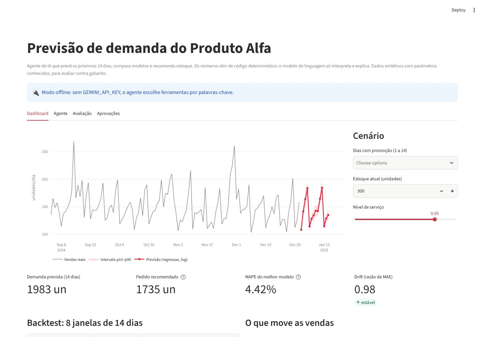
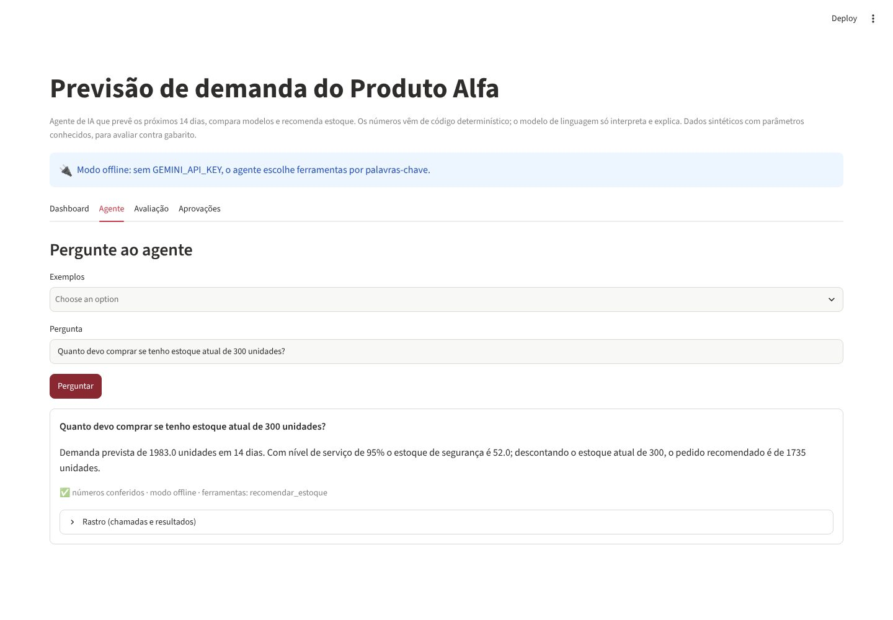

# Agente de previsão de demanda · Produto Alfa

Agente de IA que prevê as vendas diárias dos próximos 14 dias, compara modelos, explica o que move a demanda e recomenda o pedido de compra. A publicação da previsão e o retreino só acontecem com aprovação humana.

O projeto nasceu como resposta ao desafio técnico da **Valcann** (arquitetura de forecast para a empresa fictícia Logística Eficiente S.A.). A resposta original era só documento. Aqui ela virou um sistema que roda, com dashboard e avaliação contra gabarito.



## Como funciona

**O modelo interpreta, o código calcula e confere, a pessoa aprova.**

1. O Gemini lê a pergunta e escolhe as ferramentas, com saída em JSON Schema.
2. As ferramentas são código determinístico (pandas, scikit-learn e statsmodels). O modelo de linguagem nunca faz contas.
3. Antes de mostrar a resposta, o código confere se cada número citado saiu de uma ferramenta. Se algum não saiu, a resposta é marcada como **revisar**.
4. `publicar_previsao` e `disparar_retreino` são ferramentas sensíveis: viram ações pendentes que só rodam depois de aprovadas no painel.

Sem `GEMINI_API_KEY`, o agente roda em **modo offline**: escolhe a ferramenta por palavras-chave e monta a resposta a partir dos resumos das ferramentas.

| Ferramenta | O que faz |
|---|---|
| `prever_demanda` | Previsão diária com intervalo p10–p90 e dias de promoção configuráveis |
| `comparar_modelos` | Backtest com origem móvel: naive sazonal, regressão em log, GBM e SARIMAX |
| `explicar_fatores` | Efeito de promoção, feriado, tendência e dia da semana |
| `recomendar_estoque` | Pedido para cobrir 14 dias com um nível de serviço, descontando o estoque atual |
| `verificar_drift` | Compara o erro recente com o erro do backtest |
| `publicar_previsao` · `disparar_retreino` | Sensíveis: exigem aprovação |

## Resultados medidos

Backtest com 8 janelas de 14 dias. Promoções e feriados futuros são tratados como conhecidos, porque fazem parte do plano comercial.

| Modelo | MAE | MAPE |
|---|---|---|
| naive sazonal (linha de base) | 26,80 | 17,05% |
| **regressão em log** | **6,76** | **4,42%** |
| SARIMAX(1,0,1)(1,1,1,7) | 7,09 | 4,71% |
| GBM (HistGradientBoosting) | 9,28 | 5,95% |

A avaliação contra gabarito (`python eval/run_eval.py`) acertou **18 de 18 casos**:
- os efeitos reais da série foram recuperados: promoção +35,5% (o real é +35%), feriado −23,7% (o real é −25%) e a razão sábado/segunda 1,435 (o real é 1,444);
- o melhor modelo tem menos da metade do erro da linha de base;
- 10 perguntas foram roteadas para a ferramenta certa, e as ações sensíveis ficaram retidas;
- um número inventado pelo modelo foi barrado, e o número correto passou.

O detalhe de cada caso está em [`eval/resultados.md`](eval/resultados.md).

## Limites
- **Os dados são sintéticos.** O desafio não traz dados. A série foi gerada a partir de parâmetros conhecidos ([`data/parametros_reais.json`](data/parametros_reais.json)) justamente para permitir o gabarito. Dados reais têm rupturas de estoque, mudanças de preço e promoções de intensidades diferentes, e o erro seria maior.
- O MAPE de 4,42% vale para esta série. Ele mostra que o pipeline funciona, não a acurácia que se teria em produção.
- O roteamento offline é por palavras-chave. Com a chave do Gemini, a escolha de ferramentas é mais flexível, mas ainda não foi medida com o modelo real. Para medir, rode o workflow manual com o secret `GEMINI_API_KEY`.
- A publicação grava um CSV local. Na arquitetura proposta, o destino seria o S3 e o retreino dispararia um pipeline (veja abaixo).

## Como rodar
```bash
pip install -e ".[dev]"
streamlit run app/streamlit_app.py      # dashboard + agente
python eval/run_eval.py                 # avaliação contra gabarito
pytest -q                               # testes, sem rede
```
Para usar o Gemini, copie `.env.example` para `.env` e preencha `GEMINI_API_KEY`.



## Estrutura
```
src/forecastagent/
  agentcore.py   cliente Gemini, laço de ferramentas, conferência de números, aprovações
  data.py        gerador da série sintética (parâmetros conhecidos)
  models.py      modelos, backtest com origem móvel e explicação dos efeitos
  tools.py       ferramentas do agente e roteamento offline
app/streamlit_app.py   Dashboard · Agente · Avaliação · Aprovações
eval/run_eval.py       gabarito
docs/desafio/          respostas originais às três questões do desafio
```

## Arquitetura em nuvem (resposta à Questão 2)
A proposta de produção continua válida e está em [`docs/desafio/questao2_arquitetura.md`](docs/desafio/questao2_arquitetura.md), com os trechos de código corrigidos:
- dados brutos no **S3**;
- orquestração diária com **Step Functions** (ou MWAA);
- treino e inferência no **SageMaker**;
- métricas de erro no **CloudWatch**;
- retreino disparado por drift.

Este repositório implementa o miolo dessa arquitetura (modelos, backtest, monitor de drift e aprovação) de forma que dá para rodar no laptop.

As outras duas questões do desafio estão em [`docs/desafio/`](docs/desafio/): adoção de IA no varejo e app de marés.
